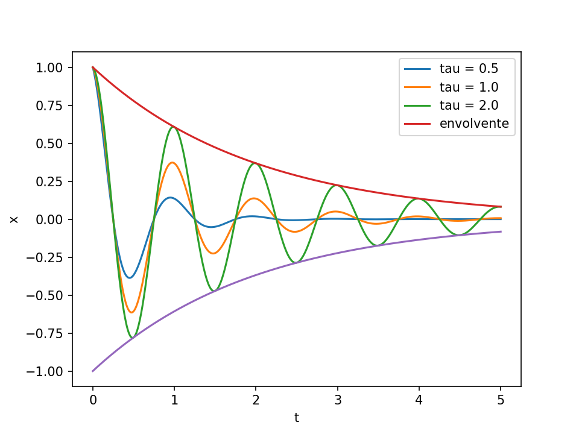
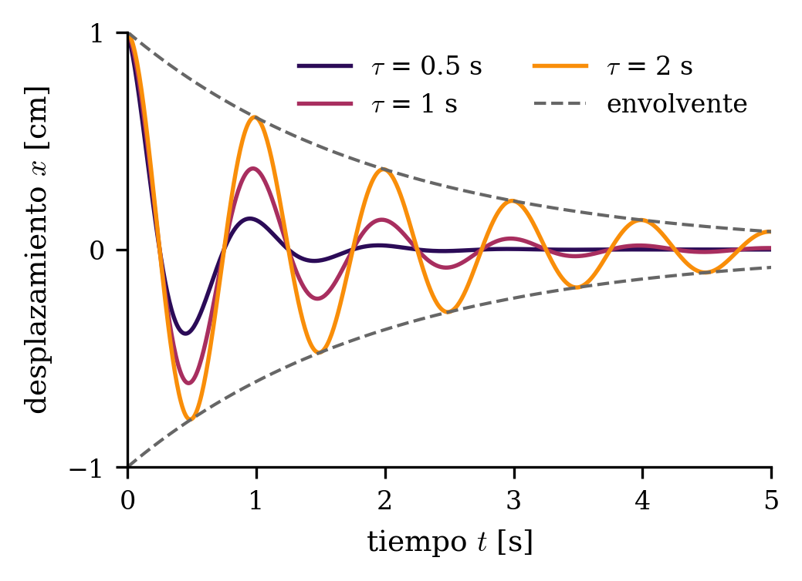

# Indicaciones generales para buenos gráficos

**Ignacio Díaz**, Ingeniería Civil Física, UTFSM. Versión 1.0, octubre de 2026.

Estas son indicaciones generales para hacer gráficos de calidad de publicación con matplotlib. 

## Ejemplo

Los mismos datos con matplotlib tal como viene (izquierda) y con las reglas de esta guía (derecha).
El código está en [`figuras/ejemplo.py`](figuras/ejemplo.py).

<p>
  
  
</p>

---

## 1. Diseñar la figura al tamaño final

La regla más importante y la que más se olvida.

- Averigua el ancho de columna de la revista o de la plantilla: suele ser unos 8.5 cm (3.35 in) a
  una columna y unos 17.5 cm (7 in) a página completa.
- Crea la figura con ese tamaño exacto, por ejemplo `figsize=(3.35, 2.4)`, e inclúyela en LaTeX sin
  escalar (`\includegraphics{...}` sin `width=`). Así el tamaño de letra que eliges es el que se lee
  impreso.
- En una presentación se puede hacer al revés: una figura grande con letra grande que se achica al
  ponerla en la lámina. En un paper eso deja la letra de tamaños desparejos entre figuras.

## 2. Letra

- Del mismo tamaño que el texto del paper, o 1 a 2 puntos menos: entre 8 y 10 pt. Nunca menos de
  7 pt después de imprimir. En una presentación, unos 12 pt ya puestos en la lámina.
- De la misma familia que el texto. Si el paper va en Computer Modern, usa
  `"mathtext.fontset": "cm"` y `"font.family": "serif"`, o `text.usetex: True` si hay LaTeX
  instalado donde corre Python. Así las ecuaciones de los ejes se ven idénticas a las del texto.
- Una sola jerarquía: rótulos de ejes y leyenda del mismo tamaño, y marcas de los ejes un punto
  menos.

## 3. Ejes y rótulos

- Todo eje lleva magnitud y unidad: "temperatura [°C]", "$z$ [m]". Una sola convención en todo el
  trabajo (corchetes o paréntesis) y la misma del texto.
- Los símbolos, igual que en el texto: $k_I/k_0$, $\tau$, con la misma notación.
- Sin marco superior ni derecho (`axes.spines.top` y `axes.spines.right` en `False`). Quita ruido sin
  perder información.
- Pocas marcas y en números redondos (0, 6, 12, 18, 24 h), en vez de las que elija matplotlib.
- Si dos paneles comparten un eje, `sharey=True` y el rótulo una sola vez.

## 4. Color

- **Mapas perceptualmente uniformes y secuenciales** (inferno, magma, viridis, cividis) para campos y
  para cualquier variable ordenada. La luminosidad sube de forma pareja, así pasos iguales de la
  variable se ven como pasos iguales de color, y se leen en blanco y negro y por personas que no
  distinguen colores. Nunca jet ni rainbow.
- **Variables con signo** (una diferencia, un error, T − T_R): un mapa divergente centrado en cero,
  como RdBu, coolwarm o vik.
- **Curvas ordenadas** (por ejemplo, un parámetro que vale 1, 10 y 100): colores tomados del mismo
  mapa secuencial, sin los extremos (de 0.15 a 0.75 del mapa), para que el negro y el amarillo pálido
  no se pierdan sobre fondo blanco. El color sube junto con el parámetro.
- **Curvas sin orden** (métodos o casos distintos): una paleta cualitativa apta para daltónicos,
  como la de Okabe-Ito o la "colorblind" de seaborn.
- **Si hace falta algo que matplotlib no trae**: los *Scientific Colour Maps* de Fabio Crameri.
  Son perceptualmente uniformes, aptos para daltónicos y legibles en blanco y negro, y varias
  revistas de geociencias los recomiendan. Hay de todos los tipos:
  - secuenciales: batlow (el más usado), lajolla, davos, oslo;
  - divergentes: vik, roma, berlin (vik ya aparece arriba, viene de aquí);
  - cíclicos, para fases o ángulos: romaO, vikO;
  - categóricos, para curvas sin orden: batlowS (colores sueltos tomados de batlow).

  En Python se instalan con `pip install cmcrameri` y se usan así:
  `import cmcrameri.cm as cmc` y `cmap=cmc.batlow`. Cita: Crameri, F. (2018), Scientific colour
  maps, Zenodo, doi:10.5281/zenodo.1243862.
- El mismo color para la misma cosa en todas las figuras del trabajo. Es lo que da coherencia.
- Prueba la figura en escala de grises. Si dos curvas se confunden, agrega otro tipo de línea
  (continua, segmentada, punteada) o marcadores.

## 5. Líneas y marcadores

- Grosor de 1 a 1.5 pt al tamaño final, más que el valor por omisión, que impreso se ve débil. En
  presentaciones, más grueso todavía.
- Las referencias (solución exacta, modelo simplificado, un criterio) en línea segmentada o
  punteada, y más delgadas que los datos.
- Marcadores solo donde hay datos discretos. Una curva continua no los necesita.
- La grilla, si se usa, muy tenue (`grid.alpha` cerca de 0.3).

## 6. Leyenda

- Sin marco (`legend.frameon: False`) y dentro de una zona vacía del panel. Mejor todavía, rótulos
  directos junto a cada curva cuando caben.
- Si varios paneles comparten leyenda, ponla una sola vez.
- En vez de una leyenda con muchas entradas, separa la información: el color para un parámetro y el
  tipo de línea para otra cosa (por ejemplo, simulación contra referencia).

## 7. Paneles

- Cada panel con su letra, (a), (b), (c), en la esquina superior izquierda, y la explicación en el
  pie de figura, no en títulos largos.
- Mismos ejes y mismas escalas cuando los paneles se comparan.
- `constrained_layout=True`, para que nada se superponga.

## 8. Campos 2D

- `aspect="equal"`, para que la geometría no se deforme.
- Barra de color con magnitud y unidad, del alto del panel.
- Escala de color fija y declarada cuando se comparan casos: el mismo color tiene que significar el
  mismo valor en todos los paneles.
- La geometría dibujada encima (contornos, puntos de medición), en un color que contraste con todo
  el mapa, por ejemplo blanco sobre inferno.
- Si una zona satura la escala, dilo en el pie de figura.

## 9. Formato del archivo

- Gráficos de líneas: PDF o EPS, que son vectoriales y se ven nítidos a cualquier zoom.
- Campos con muchas celdas: PNG a 300 a 600 dpi, o PDF con el campo rasterizado (`rasterized=True`
  en `pcolormesh` o `tripcolor`) y los ejes vectoriales. Así el archivo no pesa decenas de MB.
- `savefig(..., bbox_inches="tight")` y fondo blanco.

## 10. Reproducibilidad

- El estilo definido en un solo lugar (una función o un archivo de estilo). Así todas las figuras
  salen iguales, y cambiar algo es una línea.
- Cada figura sale de un script o de una celda que se puede volver a correr. Nada retocado a mano en
  otro programa.

## 11. Antes de entregar

- Imprime la página, o mírala al 100 %, y comprueba que todo se lee.
- Cada figura se tiene que entender solo con su pie, sin leer el texto.
- Ningún símbolo puede aparecer en una figura sin estar definido en el texto.

---

## Punto de partida para un paper a una columna

```python
import matplotlib as mpl
mpl.rcParams.update({
    "figure.figsize": (3.35, 2.4), "figure.constrained_layout.use": True,
    "savefig.dpi": 600, "savefig.bbox": "tight",
    "font.family": "serif", "mathtext.fontset": "cm", "font.size": 9,
    "axes.labelsize": 9, "legend.fontsize": 8, "xtick.labelsize": 8, "ytick.labelsize": 8,
    "lines.linewidth": 1.3, "axes.linewidth": 0.8,
    "xtick.major.width": 0.8, "ytick.major.width": 0.8,
    "axes.spines.top": False, "axes.spines.right": False,
    "legend.frameon": False, "axes.grid": False,
})
```

Si la plantilla usa letra sin serifas, cambia `font.family` a `"sans-serif"` y `mathtext.fontset` a
`"dejavusans"`. Para una figura a página completa, usa un ancho de unos 7 in.

Colores para curvas ordenadas, tomados de un mapa secuencial:

```python
import numpy as np
colores = [mpl.colormaps["inferno"](x) for x in np.linspace(0.15, 0.75, 3)]
```

---

## Cómo citar

Díaz, I. (2026). *Indicaciones generales para buenos gráficos* (versión 1.0). GitHub. https://github.com/iache-d/guia-graficos

## Agradecimientos

Al profesor Juvenal Letelier, por sus comentarios.

## Licencia

Este documento se distribuye bajo la licencia
[Creative Commons Atribución 4.0 Internacional (CC BY 4.0)](https://creativecommons.org/licenses/by/4.0/deed.es).
Puedes copiarlo, compartirlo y adaptarlo para cualquier fin, siempre que des crédito al autor.

*Asistencia de IA en la redacción.*
